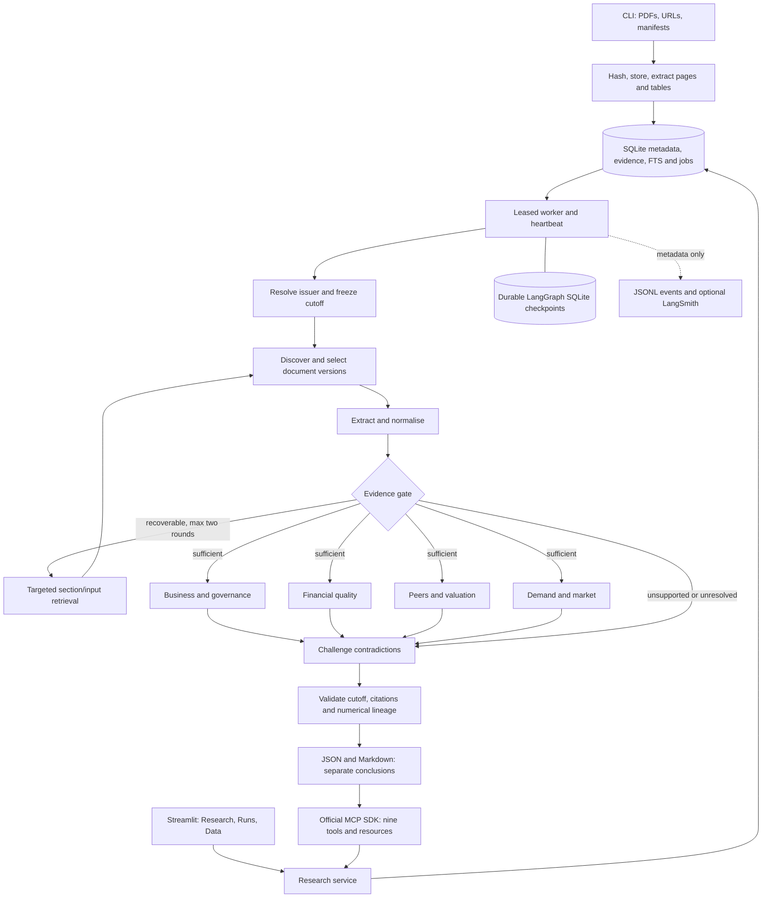

# MFetOS

Evidence-backed research for Indian mainboard, non-financial IPOs, using **Python, LangGraph, Pydantic and the official MCP SDK**. It produces separate long-term and listing conclusions, with validated JSON, readable Markdown and page-level evidence. It has no order execution capability.

## Streamlit UI, storage and tracing

```bash
.venv/bin/python -m pip install -e '.[test,ui]' -c requirements.lock
# For an existing v1 data directory, stop its workers first:
.venv/bin/python -m mfetos --data-dir data/waaree db migrate
.venv/bin/python -m mfetos --data-dir data/waaree ui
```

Open **http://127.0.0.1:8501**. The launcher supervises Streamlit and a worker; closing the browser does not cancel durable jobs, and widget reruns never spawn another worker. Ctrl+C stops only the launcher's own children. If you run Streamlit directly instead, start `mfetos worker` separately with the same data directory.

The **Research** tab accepts uploaded PDFs and HTTPS URLs, explicit issuer/publication details, a parser selection and an India-time analysis cutoff. Ingestion and analysis execute in the durable queue. **Runs** lists saved research and lets you resolve existing material ambiguities or retry failures. **Data** provides read-only, paginated named-table views. Reports show the two conclusions separately, with financial tables, gaps, downloadable JSON/Markdown and original-page evidence. Uploaded bytes are stored under content hashes; publication verification is never inferred from an upload date.

The research store now has named tables for issuers, IPOs, documents, extraction versions, pages/table cells, facts/evidence, runs, metrics, job attempts and events. See the [schema diagram, inspection queries and migration/rollback instructions](docs/storage.md). Migration preserves existing IDs/reports and makes a timestamped backup; the LangGraph checkpoint file is not rewritten.

### Optional Docling parsing

Docling is integrated as a selectable local backend. pdfplumber remains the lightweight default.

```bash
.venv/bin/python -m pip install -e '.[docling]'
.venv/bin/python -m mfetos parsers prepare
```

The explicit preparation command downloads local layout, table and RapidOCR models into `<data-dir>/models/docling`. It does not download VLM/audio models. Select **docling** in the UI, set `MFETOS_PDF_PARSER=docling`, or set a document's `parser_backend` in its manifest. When using another data directory, set `MFETOS_DOCLING_ARTIFACTS_PATH` to the prepared directory or prepare that directory separately.

Conversion uses local models with remote services disabled. Missing packages/models and incomplete conversions are explicit errors; there is no silent switch to another parser. Page references, table grids, bounding boxes and raw Docling JSON are retained. Extraction caches include backend, installed package version and options; frozen runs retain their extraction revision.

### Logs and LangSmith

Copy `.env.example` to `.env` and configure:

```dotenv
LANGSMITH_TRACING=true
LANGSMITH_API_KEY=your-key
LANGSMITH_PROJECT=mfetos
LANGSMITH_ENDPOINT=https://api.smith.langchain.com
```

Tracing is off by default and is strictly **metadata only** when enabled: IDs, stages, durations, counts and safe error codes. PDF/evidence text, model messages, report contents, credentials and signed URLs are never exported. Implicit LangGraph state tracing is suppressed even if global tracing variables are enabled. Explicit SDK spans connect ingestion, graph nodes and fetch operations; the UI shows a LangSmith link when the exporter can obtain it. Network/authentication failures leave local research operational.

Structured JSONL logs go to stderr and `<data-dir>/logs/mfetos-<pid>.jsonl`, with rotation; operational events also appear in the run timeline. `MFETOS_LOG_LEVEL` and `MFETOS_LOG_DIR` configure local output. Metadata-only logging applies at DEBUG too. MCP stdout remains reserved for its protocol. Keys are read from settings, not collected by the UI.

## Run it

Python 3.11+ is required. From the repository root:

```bash
python -m venv .venv
.venv/bin/python -m pip install -e '.[test,ui]' -c requirements.lock
.venv/bin/python -m pytest -q
.venv/bin/python -m mfetos providers
```

The existing project environment was used for development. `requirements.lock` pins the tested dependency set, including development tools; the package itself has fewer direct dependencies. No LLM account or paid data API is required. Copy `.env.example` to `.env` to change defaults. All data stays under `MFETOS_DATA_DIR` (`./data` by default).

### Real prospectus example

```bash
.venv/bin/python examples/run_waaree.py
```

This ingests the real **Waaree Energies October 2024 RHP, price-band notice and corrigendum**, verifies their SHA-256 hashes, and analyses them at **2024-10-17 23:59:59 India time**. The RHP is 626 PDF pages, so the first ingestion can take several minutes. Subsequent runs reuse the original extraction. Outputs are `output/waaree-2024/report.json` and `report.md`; the research database is `data/waaree`.

If the websites are unavailable, supply the same originals locally:

```bash
.venv/bin/python examples/run_waaree.py --rhp /path/rhp.pdf \
  --price-band /path/price-band.pdf --amendment /path/corrigendum.pdf
```

The example does **not** inject pre-extracted company facts or a prewritten report. It extracts annual/interim financials, owners' earnings, CFO, capex, price band and pre-issue shares from the PDFs. It returns **insufficient evidence** where conflicts, employee/dilution details, independent peer selection or demand evidence remain unresolved. That is a successful research outcome, not a fabricated valuation. It never uses the final offer prospectus, later subscription totals or listing returns.

Original PDFs and generated research are excluded from Git. The supplied manifest documents publication eligibility decisions, conservative day-end timestamps and source URLs. This is a retrospective reconstruction from dated public disclosures; it is not a contemporaneously captured web archive. See [historical evaluation](docs/evaluation.md) before treating it as a backtest.

### Your own prospectus

Create a JSON manifest following `examples/waaree-2024/manifest.json`. Set the issuer's legal name, issue ID, board and sector; point `location` to a local PDF or public HTTPS URL. Local paths resolve relative to the manifest. Keep `source_url` as the original provenance URL.

```bash
.venv/bin/python -m mfetos ingest /path/manifest.json
.venv/bin/python -m mfetos search waaree
.venv/bin/python -m mfetos analyze waaree-2024 --as-of '2024-10-17T23:59:59+05:30' --wait
.venv/bin/python -m mfetos status RUN_ID
.venv/bin/python -m mfetos report RUN_ID --format markdown --output output/research.md
.venv/bin/python -m mfetos report RUN_ID --format json --output output/research.json
```

Use the **same data directory** for ingest, analysis and MCP. For the example's database, add `--data-dir data/waaree` before the subcommand.

`analyze` immediately enqueues a durable job. `--wait` runs an embedded worker; otherwise start `mfetos worker` or the MCP server. An unknown board/sector or mismatched legal identity pauses only that run. Inspect `status`, then resolve it explicitly:

```bash
.venv/bin/python -m mfetos resume RUN_ID --decision '{"board":"mainboard","sector":"manufacturing"}'
.venv/bin/python -m mfetos worker
```

Identity mismatches require `{"accept_identity": true}` after reviewing the source. Failed runs can be resumed with `mfetos retry RUN_ID`, followed by a worker. Revised inputs create a new run; duplicate requests with the same cutoff, source/configuration revision and code revision reuse the existing run.

## MCP

```bash
.venv/bin/python -m mfetos --data-dir data/waaree serve
```

Example host configuration, using absolute paths:

```json
{
  "mcpServers": {
    "mfetos": {
      "command": "/absolute/path/mfetos/.venv/bin/python",
      "args": ["-m", "mfetos", "--data-dir", "/absolute/path/mfetos/data/waaree", "serve"]
    }
  }
}
```

The server uses local stdio and starts its own recoverable worker. Stdout is reserved for protocol messages. It exposes:

- `search_ipos(query, status, board)` — searches registered issuer identities.
- `get_ipo_documents(ipo_id, as_of)` — eligible document versions, hashes and provenance.
- `get_ipo_facts(ipo_id, as_of)` — structured facts and evidence.
- `get_peer_comparison(ipo_id, peer_ids, as_of)` — registered peer financials and explicit selection rationale.
- `get_subscription_snapshot(ipo_id, as_of)` — timestamped observations, preserving scopes/denominators.
- `start_ipo_analysis(ipo_id, objective, as_of)` — durably returns a `run_id`.
- `get_analysis_status(run_id)` — stage, errors and any required decision.
- `get_analysis_report(run_id)` — validated JSON plus Markdown, or `not_ready`.
- `get_evidence(evidence_id)` — bounded source excerpt with original and printed page references.

`objective` is `both`, `long_term` or `listing`. The shared research graph retains both conclusions so their differing evidence coverage remains visible. Explicit cutoffs must include a timezone; omitted cutoffs freeze the current instant.

Resources: `ipo://reports/{run_id}/report.json`, `ipo://reports/{run_id}/report.md`, `ipo://evidence/{evidence_id}`. Upload/registration is through the local CLI or Streamlit UI, avoiding arbitrary filesystem access through MCP. The UI binds to localhost; MCP uses stdio.

## Evidence and financial rules

Publication metadata is a **trusted analyst input**, not an LLM assertion. `publication_status: verified` requires a publication-evidence reference or note. The application validates timestamps and availability rules; it cannot prove an arbitrary user attestation. Undated, merely declared and post-cutoff sources are excluded. A document may be retrieved later if its historical public availability is independently established. Never backdate `retrieved_at`.

Facts and evidence are separate normalised records linked by IDs. `get_ipo_facts` and reports include both, preserving metric/value/unit/currency, fiscal period, consolidated/standalone basis, reported/normalised/projected status, category, validation, source URL, document ID, PDF/printed page and publication/retrieval timestamps. Decimal amounts are encoded as JSON strings to preserve precision. `validated` means extraction/lineage checks passed, not that management's statements are independently true.

Document versions remain immutable. An amendment changes only its declared `amended_metrics`; contradictory same-priority values are marked conflicting and excluded from calculations. Historical peer results are selected by publication availability, not fiscal period alone. Full-text section retrieval supplements structured table extraction; no vector database is required.

Calculations are deterministic Python with formula definitions and input fact IDs. In particular:

- Annual/interim and consolidated/standalone cohorts remain distinct; interim earnings are not annualised.
- CAGR uses elapsed years; negative/zero or unknown denominators are unavailable.
- Missing values, dashes and placeholders are never converted to zero. Explicit reported zero remains zero.
- Market cap/P/E use post-issue diluted shares and owners' earnings, separately from historical weighted-average EPS. Fixed-proceeds issuance is endpoint-specific and indicative before allocation.
- OFS neither issues new shares nor provides company cash. Company-borne expenses and planned uses enter the cash bridge once. Debt repayment reduces debt and cash together.
- EV uses the latest eligible balance-sheet date, explicit cash availability, preference capital, NCI and an explicit lease/debt definition; missing bridge components block it. Lease liabilities are added once when excluded from debt, alongside reported Ind AS earnings.
- ROE/ROCE and turnover use average balances where available. Capex outflows retain their reported sign; FCF subtracts their magnitude.
- Scenario multiples require explicit bear/base/bull assumptions and rationale. They are sensitivities at both price endpoints, not forecasts, return probabilities or validated price targets. No DCF is manufactured.

The parser supports labelled offer fields and conventional financial tables with readable dates, basis and scale. It deliberately abstains on ambiguous grids. Business/governance review is extractive, optionally augmented by source-matched model quotes and separately labelled interpretations. It does not exhaustively audit every litigation, contract or accounting note. Unusual layouts, industry-specific KPIs, corporate actions and tax-sensitive normalisations require analyst review. Deterministic helpers cover explicit split/bonus adjustments, after-tax earnings adjustments and discounted issuance tranches; the extractor does not guess their terms or automatically apply them twice.

For an explicit analyst sensitivity, supply `scenario_multiples` with positive ordered `bear`, `base`, `bull` values and `scenario_rationale`. Optional `peer_ids` refer to separately ingested reports. `peer_rationales` maps included peer IDs to documented business-mix/growth/margin/size/capital-intensity reasoning; otherwise candidates are excluded from relative valuation. Peer P/E additionally requires dated price and action-adjusted listed-share evidence. Consumer vendor snapshots without point-in-time provenance are not historical fundamentals.

### Subscription observations

No undocumented exchange subscription endpoint is assumed. `subscription_sources` can map an observation to an original PDF page and quote. The conservative adapter requires an original labelled line, for example:

```text
qib scope consolidated bids 300 offered 100 shares anchors excluded observed 2024-10-17T12:00:00+05:30
```

Map `source_url`, `pdf_page`, `quote`, `observed_at`, `scope`, `category`, `bids`, `offered`, `unit`, `anchor_treatment` in the manifest. Both the quote and values must match the supplied original; publication cannot precede observation. The application creates the evidence/snapshot IDs. This format is also useful for licensed-provider exports. Do not create a synthetic observation and describe it as exchange data.

Eligible consolidated snapshots take precedence over exchange-specific data. Exchange-only observations remain separate unless explicitly disjoint, simultaneous and compatible in units/anchor treatment. Cumulative snapshots are never summed; category parents and children are never added into a total. Conflicting identical-time observations are excluded. GMP has no role in fundamental valuation or a guarantee of listing returns.

## Architecture



Named SQLite tables and inspection views replace the generic JSON object store; see [database layout and migration](docs/storage.md). SQLite is appropriate for this single-user local MVP. Queue leases and checkpoints survive process restarts; expired leases are reclaimed after up to 60 seconds. Independent branch outputs are persisted and joined once. Nodes have bounded timeouts, external fetches have three attempts, retrieval has a configurable round budget, and content hashes prevent duplicate document work. Model text has no filesystem, shell, broker or unrestricted tool access. Secrets are settings values and never enter graph state or prompts.

## Discovery, models and providers

```bash
.venv/bin/python -m mfetos discover 'Waaree'
```

Discovery inspects public SEBI and Axis Capital document links. Results are candidates, not a comprehensive IPO calendar and not automatically publication-verified. Supplied issuer/BRLM, peer annual reports, credit rationales, MCA and RBI URLs use the generic public adapter. Blocked/authenticated sources remain explicit failures. NSE automated collection is disabled under its terms; BSE requests may be denied. Access controls are never bypassed.

For optional local model interpretation, install/run Ollama yourself, download a suitable model, then configure `MFETOS_LLM_PROVIDER=ollama` and `MFETOS_OLLAMA_MODEL`. The adapter uses the documented local `/api/chat` JSON-schema interface. It accepts exact source quotes only and marks interpretation as inference. Model arithmetic never enters financial calculations. The deterministic path remains fully runnable when the model is unavailable.

[Provider capabilities and usage restrictions](docs/providers.md) records what was verified. Upstox has an optional read-only Python adapter, gated on credentials, applicable licensing and retained-data rights. Its responses are not automatically treated as audited or point-in-time data. Tavily is disabled pending terms clarification; Kite is evaluated/deferred; TrueData needs a licensed corporate-data contract. Screener is manual only.

## Tests and evaluation

```bash
.venv/bin/python -m pytest -q
.venv/bin/python -m ruff check src tests examples
MFETOS_LIVE_TESTS=1 .venv/bin/python -m pytest tests/test_real_prospectus.py -q
# After installing .[docling] and running parsers prepare in the default data directory:
MFETOS_DOCLING_LIVE=1 .venv/bin/python -m pytest tests/test_docling_live.py -q
```

The ordinary suite is offline and uses clearly fictional prospectus data under `tests/fixtures/`, rendered into temporary PDFs. It covers arithmetic, source selection, fiscal/basis separation, dilution/proceeds/leases, subscription deduplication, unsupported/insufficient evidence, human resume, durable checkpoint recovery and a complete ingestion-to-report-to-MCP subprocess path. It also covers populated migration/rollback, Streamlit reruns and ingestion controls, parser provenance, and metadata-only/failing trace exporters. LangSmith network export is disabled in the offline suite. The opt-in real test can use existing originals via `MFETOS_WAAREE_RHP`, `MFETOS_WAAREE_PRICE_BAND` and `MFETOS_WAAREE_AMENDMENT`. The local Docling tests exercise table extraction through to a cited report and image-only PDF OCR using already prepared models.

The [evaluation plan](docs/evaluation.md) separates extraction accuracy, citation support and numerical correctness from investment outcomes, and requires archived point-in-time inputs to prevent look-ahead leakage.
