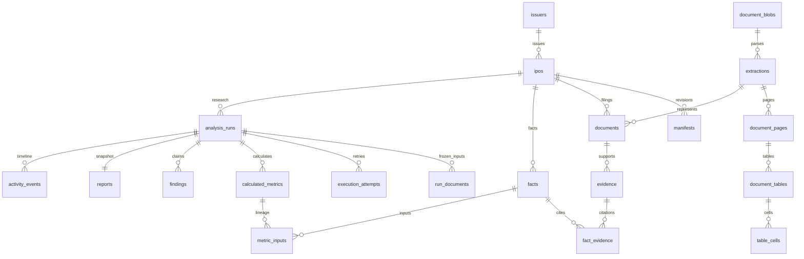

# Research database, version 2

MFetOS uses a local SQLite research database and a separate LangGraph checkpoint database. Financial values are decimal strings, so reads and writes never round money through SQLite floating-point values. Tables expose ordinary columns for issuer, metric, fiscal period, basis, validation, publication time and run status. JSON is reserved for immutable manifests/reports, variable lists and parser options.



`jobs` is the shared leased queue for analysis and ingestion. `ingestion_jobs` stores upload/import progress; `human_decisions` preserves interrupted-run decisions until a resumed graph invocation has checkpointed. `run_snapshots`, `run_documents`, `run_facts` and `run_evidence` preserve run-specific inputs and peer/business/report relationships. `execution_attempts` stores separate attempt/trace IDs for retries and resumptions.

## Inspect the data

Start `mfetos --data-dir data/waaree ui` and open the **Data** tab, or use:

```bash
mfetos --data-dir data/waaree db summary
sqlite3 -readonly data/waaree/research.sqlite
```

The three readable views are `financial_facts`, `document_coverage` and `run_summary`:

```sql
SELECT legal_name, metric, value_decimal, unit, period_end, basis,
       validation, pdf_page, source_url
FROM financial_facts
WHERE ipo_id = 'waaree-2024' AND metric IN ('revenue', 'pat_owners', 'cfo');

SELECT document_id, kind, published_at, publication_status, backend,
       page_count, evidence_count
FROM document_coverage
WHERE ipo_id = 'waaree-2024';

SELECT run_id, as_of, status, stage, long_term_status, listing_status
FROM run_summary ORDER BY created_at DESC;
```

A fact with multiple citations appears once per citation in `financial_facts`. This view is for inspection, not aggregation into financial statements. Deterministic Python calculations select facts, preserve basis/periods and record their exact input IDs. The UI browser is read-only, limits each page to 50 records and accepts table/view names only from the schema allowlist; it has no arbitrary SQL editor.

## Existing v1 databases

Stop other workers/servers using the data directory, then run:

```bash
mfetos --data-dir data/waaree db migrate
```

The command first makes a consistent SQLite backup named `research.pre-v2-<UTC>.sqlite`, including WAL contents. It then transfers recognised legacy records inside one schema/data transaction, validates record counts, complete reports, facts, evidence and foreign keys, and only then drops `objects`, the old FTS index and old queue. Unrecognised record kinds or validation failures roll back the transaction. Running migration again is harmless.

Original PDF files and `checkpoints.sqlite` are not rewritten. Existing IDs, report snapshots and checkpoint thread IDs remain usable. Queue leases from stopped v1 processes are reclaimed. An application refuses to use a legacy database until explicit migration; it does not attempt a large migration during a Streamlit rerun.

To roll back, stop every v2 process first, then restore the backup with SQLite's backup API into `research.sqlite` (which safely handles WAL files) and run the old application version. Keep the v2 database separately if you need its newer research. Avoid copying a database file over an active connection.
